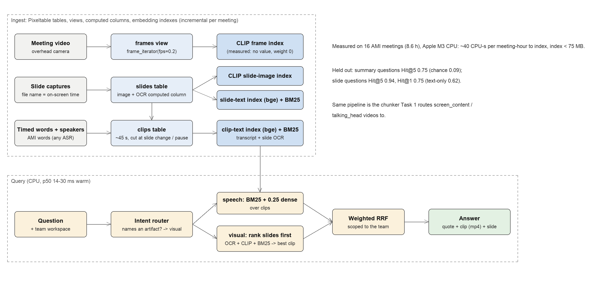

# Meeting memory: multimodal retrieval over recorded meetings

Ask a question about a team's past meetings and get back **the quote, the
exact clip and the slide that was on screen**:

```
$ python src/main.py ask --team ES2002 "what did they decide about teletext?" "show me the slide with the components diagram"
Q: what did they decide about teletext?
  1. ES2002b 01:40-02:38  [bm25#2 dense#1]
     "Project Manager: Um just want to tell you that you have three new requirements, um which is the The first one
      is that um uh the company's decided that teletext is outdated uh because of how popular the internet is. Nobod"
Q: show me the slide with the components diagram
  1. ES2002c 17:27-17:48  [bm25#3 slides#1]
     slide: .../ES2002c/slides/ES2002c.992.87__1051.25.jpg
```

With `--export DIR` each hit is also written out as an mp4 clip, the slide and the best frame.

Built on **[Pixeltable](https://github.com/pixeltable/pixeltable)** (Apache-2.0),
an open-source multimodal data SDK, and the **AMI Meeting Corpus** (CC BY 4.0):
real design meetings with video, slide captures, transcripts, and human-written
summaries that link back to the exact moments that support them. Those links
give us a retrieval benchmark without hand-labelling.

Write-up (problem, approach, results, cost, what's next): **[docs/README.md](docs/README.md)**.
Full results tables: [docs/results.md](docs/results.md).

## Run it

```bash
pip install -r requirements.txt
python src/main.py download                      # ES2002 a-d: annotations + video + slides (~400 MB)
python src/main.py download --no-video --meetings ES2003a ES2003b ES2003c ES2003d IS1009a IS1009b IS1009c IS1009d TS3003a TS3003b TS3003c TS3003d
python src/main.py index                         # Pixeltable index for the dev meetings (with video)
python src/main.py index --no-video --meetings ES2003a ES2003b ES2003c ES2003d IS1009a IS1009b IS1009c IS1009d TS3003a TS3003b TS3003c TS3003d
python src/main.py eval                          # benchmark -> docs/results.md
python src/main.py ask --team ES2002 "show me the slide with the components diagram" --export artifacts/answers
python -m pytest -q
```

`run.yaml` has the exact commands the evaluator runs. CPU only; no API keys.

## How it works



Editable diagram: [docs/figures/architecture.drawio](docs/figures/architecture.drawio).
Docs: [summary](docs/README.md) · [results](docs/results.md) · [benchmark](docs/benchmark.md) ·
[SDK usage + gaps](docs/sdk_usage.md) · [deployment](docs/deployment.md) · [approaches + cost](docs/approaches.md).

| module | what it does |
|---|---|
| `src/mmr/download.py` | AMI annotations, one camera view, slide captures; parallel byte ranges + retries |
| `src/mmr/ami.py` | NXT parsing: timed words, speaker roles, summary sentences and their evidence spans |
| `src/mmr/chunking.py` | words -> utterances -> clips cut at slide changes, pauses or 45 s |
| `src/mmr/index.py` | the Pixeltable schema: tables, frame view, OCR UDF, 4 embedding indexes |
| `src/mmr/search.py` | 6 channels, intent routing, slide-first visual path, weighted RRF, optional cross-encoder |
| `src/mmr/evaluate.py` | benchmark from AMI summary links + hand-labelled visual questions; Hit@k, MRR, Meeting@1, Slide@1, bootstrap CIs |
| `benchmark/` | the 34 hand-written "show me the slide ..." questions (18 dev, 16 held out) |
