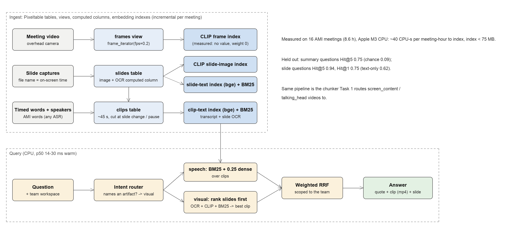

# Task 8: meeting memory, find the moment, the quote and the slide

## The problem

Product teams decide things in meetings, then lose them. Six weeks later nobody
remembers *why* the remote has no teletext button, or which slide showed the
cost breakdown. Meeting tools (Otter, Zoom AI, Gong) search transcripts, but
meetings are multimodal: people say "this one" while a slide is on screen,
and many questions are "show me the slide where...".

**Goal:** ask a team's meeting archive a question; get back the quote, the
exact clip and the slide that was on screen, fast and on a CPU.

## Data, and a benchmark we didn't have to label

**AMI Meeting Corpus** (CC BY 4.0): real 4-person design meetings with video,
slide captures and word-timed transcripts. Human-written summaries are linked
to the exact utterances behind each sentence, so every summary sentence is a
query with known evidence times. Slide file names carry their on-screen times
(`ES2002b.284.31__307.96.jpg`), so "show me the slide" can be scored too.

Dev = team ES2002 (4 meetings, 69 + 18 questions); every choice was made here.
**Held out = 12 meetings from 3 other teams at 3 sites (204 summary + 16
visual questions)**, scored once. Each query searches its team's workspace,
as access control would. Details and biases: [benchmark.md](benchmark.md).

## Approach

**SDK: Pixeltable.** Meetings, slides and clips are Pixeltable tables; a
`frame_iterator` view samples video at 0.2 fps; a `@pxt.udf` computed column
OCRs each slide; four embedding indexes (CLIP on frames and slide images,
bge-small on clip text and slide text) stay current as meetings are inserted,
and `.similarity()` + `where(meeting_id.isin(team))` ranks within a
workspace. Code and the gaps found: [sdk_usage.md](sdk_usage.md).

**Chunking.** Timed words → utterances → about 45 s clips, cut early at slide
changes and pauses. This is the chunker the Task 1 classifier routes
`screen_content` / `talking_head` videos to.

**Routing.** A rule router reads intent. *Speech* questions (most) use
BM25 + 0.25 × dense over clips. *Visual* questions (they name an artifact:
slide, diagram, email, photo of...) **rank slides first** (OCR-dense +
OCR-BM25 + CLIP image) and return the clip under each slide whose words fit
best. Weighted reciprocal-rank fusion; weights from the dev set.

## Results (held out, team-scoped)

| | summary questions (204) | visual questions (16) |
|---|---|---|
| random ranking, Hit@5 | 0.09 | 0.08 |
| BM25 only | Hit@5 0.71 · MRR 0.56 | Hit@1 0.69 · MRR 0.75 |
| text profile everywhere | Hit@5 **0.75** · MRR 0.55 | Hit@1 0.62 · MRR 0.74 |
| visual profile everywhere | Hit@5 0.32 · MRR 0.24 | Hit@1 **0.75** · Hit@5 **0.94** · MRR **0.80** |
| **routed by intent (shipped)** | Hit@5 **0.75** [0.69, 0.81] · MRR 0.54 | Hit@1 **0.75** · Hit@5 **0.94** · MRR **0.80** |
| routed, all 16 meetings at once | Hit@5 0.56 | Hit@5 0.81 |

Warm latency p50 14 ms (speech) / 30 ms (visual). Every channel, dev sets,
Slide@1 and CIs: [results.md](results.md).

**What we learned**

1. **No single fusion wins both kinds of question.** The visual profile is the
   best on visual questions and the worst on speech questions. Routing keeps
   the best of each; the router misroutes 1 of 273 summary questions and 0 of
   34 visual ones.
2. **Keywords beat the dense model on meeting speech.** BM25 alone nearly
   matches the hybrid. Small embedders struggle with "um so the uh battery".
3. **Rank the artifact, not the transcript.** Spreading each slide's vote over
   the clips under it made things worse; ranking slides first fixed it. CLIP
   on slide *images* is the best single slide channel (photos and diagrams
   have little text).
4. **The frame channel found nothing.** The overhead camera (352×288,
   top-down) scored about 0 on every set, so it stays indexed with weight 0.
   We measured that rather than assumed it.
5. **Scope matters more than models.** All AMI teams designed the same
   product; searching everyone at once drops Hit@5 from 0.75 to 0.56.

**Limits.** Summary sentences favour text. The visual sets are small and
written by me; the routed gain is p = 0.03 on dev but p = 0.24 held out
(n = 16): directional. Transcripts are manual; the ASR ablation is next.

## Cost

About **40 CPU-seconds per meeting-hour** to index when the platform supplies
the transcript (slides 24 s, frames 14 s, text 1.4 s; Apple M3), and an index
under 75 MB for 8.6 h. 10,000 meeting-hours ≈ 110 CPU-hours (≈ $5-10); own
ASR would dominate at about 6-12 CPU-min per hour. Queries stay in
milliseconds because they never leave a workspace. Serving, scaling,
monitoring and privacy: [deployment.md](deployment.md). The eight approaches
weighed, with cost, are in [approaches.md](approaches.md).

## Next

Measure on AMI's ASR transcripts; VLM captions at slide changes and
close-up camera views for scene questions ("when did they show the
prototype?"); swap the rule router for the Task 2 intent classifier; a short
cited answer on top of the clips; scale to all ~140 annotated meetings.
