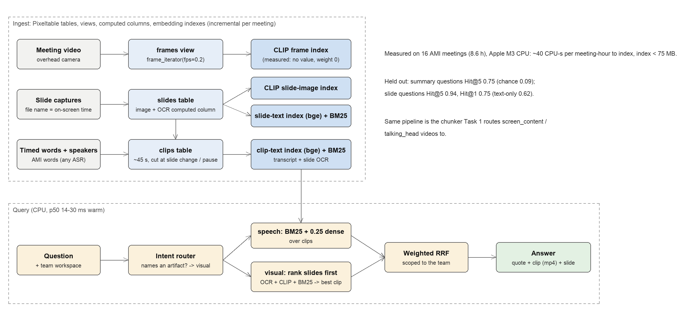

# Deployment plan

Editable source: [figures/architecture.drawio](figures/architecture.drawio) (open in diagrams.net).

## Serving path

1. **Meeting ends** → a webhook from the meeting platform (Zoom / Teams / Meet)
   delivers the recording, the transcript with speaker names, and the shared
   screen. Files go to object storage; a message goes on a queue.
2. **Ingest worker (CPU)** pulls the job: it detects slide changes in the
   screen-share stream, which produces the slide captures AMI ships pre-cut;
   uses the platform transcript, or runs ASR when there is none; then inserts
   the meeting into Pixeltable. OCR, embeddings and index updates run as
   computed columns. Workers are stateless and scale on queue depth.
3. **Query service** (stateless, warm models) receives
   `question + user`, resolves the user's **workspace** from the access-control
   list (team / project / meeting invitations), runs the routed search inside
   that scope, and returns quote, clip URL (a signed link with start/end) and
   slide image.
4. **Optional answer layer**: an LLM writes a 2-sentence reply that cites
   only the returned clips. Retrieval stays the source of truth.

The Task 1 classifier sits in front of step 2 for mixed corpora:
`talking_head` and `screen_content` videos get this chunker (slide changes +
pauses); other classes go to their own chunkers.

## Throughput and cost

| | measured (16 meetings, 8.6 h) | 10,000 meeting-hours |
|---|---|---|
| index compute | ~40 CPU-s per hour (transcript provided) | ~110 CPU-hours ≈ $5-10 on spot CPUs |
| with own ASR (faster-whisper-small, est.) | ~6-12 CPU-min per hour | ~1,000-2,000 CPU-hours: ASR dominates; use a GPU batch |
| index on disk | < 75 MB (incl. Postgres catalog) | ~10 GB of vectors + text; video stays in object storage |
| query | p50 14-30 ms warm, one process | per-workspace indexes keep queries flat as the corpus grows |

Cost is linear in hours ingested. Queries do not grow with the corpus because
they never leave a workspace. Pixeltable runs against an external Postgres
for multi-node; BM25 moves to Postgres full-text or OpenSearch above about
10^6 clips.

## Keeping it accurate

* **Click logs as labels.** Which clip a user plays, and for how long, is free
  relevance feedback; re-tune the fusion weights monthly on it.
* **Router audit.** Sample questions routed "visual" vs "speech" weekly; the
  rule router is a placeholder for the Task 2 intent classifier.
* **Per-tenant vocabulary.** Product names and acronyms break small embedders
  first; BM25 covers them, which is one reason it carries the most weight.

## Monitoring

Ingest lag (meeting end → searchable), OCR empty-rate per slide, share of
queries with no hit above a score floor, p95 latency, router mix.

## Failure handling

* A failed stage marks the meeting partial. Transcript-only search still
  works without slides or video.
* AMI-style flaky sources: downloads use byte ranges, retries with backoff,
  and atomic renames; re-runs are idempotent.
* Model download failure at start-up: the service refuses traffic rather
  than serving a half-built index.

## Data handling

Meetings are personal data. Respect platform consent flags, keep the
retention policy per workspace (deleting a meeting deletes its rows and
vectors), never index across workspaces, and keep raw video in the
customer's own storage when they require it.
